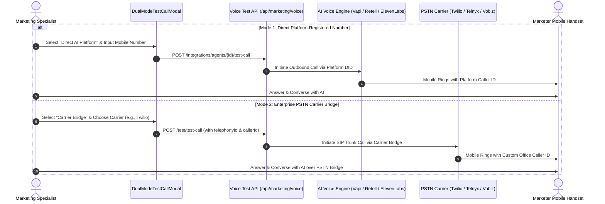

Before launching an AI voice campaign to thousands of prospective property buyers, marketing managers must verify agent behavior under real conversational conditions. A slight mispronunciation of a project landmark, an awkward silence gap, or an overly aggressive interruption threshold can harm customer trust.

BrokerOS provides a comprehensive **Dual-Mode Test Calling** suite (`DualModeTestCallModal.tsx`) and an **In-Browser Audio Preview Studio** (`InBrowserAudioPlayer.tsx`) to stress-test personas without burning campaign credits or contacting live prospects.

---

## Dual-Mode Test Call Architecture

The test call modal supports two distinct verification modes depending on how you intend to route production calls:

---

## The Two Test Calling Modes

### Mode 1: Direct AI Platform Dialing
In direct mode, the call is initiated through the AI platform's purchased virtual telephone number:
- **Available Platforms**: Supported on **Vapi**, **Retell AI**, and **ElevenLabs**.
- **Phone Number Resolution**: Automatically fetches active phone numbers registered inside your AI platform workspace (`/api/marketing/voice/integrations/agents/{id}/phone-numbers`).
- **Ideal Use Case**: Testing new system prompt scripts, conversational cadence, and interruption handling before connecting corporate telecom trunks.

### Mode 2: Carrier Bridge PSTN Dialing
In carrier bridge mode, the call routes through your organization's connected telecom trunk:
- **Supported Telecom Carriers**: **Twilio**, **Telnyx**, **Vobiz**, and **Exotel**.
- **Caller ID Customization**: Displays your verified corporate real estate sales line on your handset.
- **Telecom Audio Verification**: Evaluates real-world cellular audio compression, background network latency, and call setup time across physical mobile networks.
- **Ideal Use Case**: Final pre-flight verification to confirm that the full SIP trunk and media stream pipeline functions seamlessly.

---

## In-Browser Audio Preview Studio

For rapid prompt iteration without placing a phone call, the **In-Browser Audio Player** (`InBrowserAudioPlayer.tsx`) synthesizes and plays audio directly inside the web browser:

<CardGroup cols={2}>
  <Card title="Multi-TTS Provider Synthesis" icon="music">
    Synthesizes sample sentences in real time across six leading TTS engines: Cartesia Sonic, Deepgram Aura, ElevenLabs, MiniMax, OpenAI TTS, and Sarvam Indic TTS.
  </Card>
  <Card title="Interactive Waveform Display" icon="waveform-lines">
    Visualizes audio frequencies with play, pause, seek, and loop functionality.
  </Card>
  <Card title="Cadence & Speed Control" icon="gauge">
    Test conversational delivery at 0.75x, 1.0x, 1.25x, 1.5x, and 2.0x playback speeds.
  </Card>
  <Card title="Instant Local Pronunciation Check" icon="spell-check">
    Ensure developer names, project addresses, and Indian numerical units (Crores, Lakhs) are articulated with natural inflection.
  </Card>
</CardGroup>

---

## Testing Real Estate Objection Scenarios

When performing a live test call, marketing teams are encouraged to role-play standard buyer objections to evaluate persona resilience:

| Test Scenario | Sample Prompt Objection | Expected AI Agent Response |
| :--- | :--- | :--- |
| **Pricing Resistance** | *"₹2.4 Crore is way beyond my current budget."* | Acknowledges budget constraints, highlights the milestone-linked 20:80 payment scheme, and offers to share details on smaller 2BHK configurations. |
| **Location / Transit Concern** | *"Sector 62 is too far from my workplace in Central Cyber City."* | Explains the upcoming metro extension corridor and 15-minute signal-free highway connectivity. |
| **Interruption Testing** | Interrupt the agent mid-sentence while it quotes amenities. | Agent must instantly halt speech output (< 200ms threshold), listen attentively to your interjection, and respond naturally without talking over you. |
| **Visit Scheduling** | *"I can only visit on Sunday afternoon around 3 PM."* | Confirms Sunday at 3:00 PM, asks if you will be accompanied by family, and prepares calendar task confirmation. |

---

## Test Call State Machine

During execution, `DualModeTestCallModal` displays real-time connection telemetry:

- **`idle`**: Standby state awaiting user phone input.
- **`ringing`**: Outbound SIP INVITE packet dispatched; awaiting handset answer.
- **`connected`**: Call answered; bidirectional media stream active and audio packets streaming.
- **`failed`**: Carrier timeout, busy line, or invalid phone number formatting error reported.
