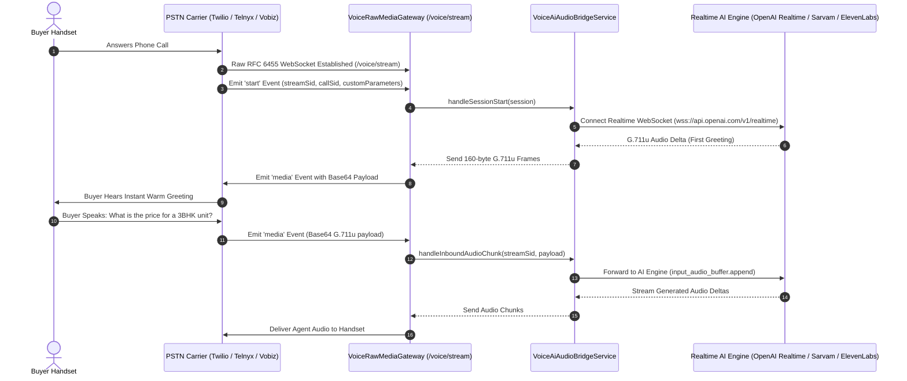

When connecting outbound PSTN phone calls to conversational AI engines over a carrier bridge, audio must travel bi-directionally with sub-second latency. Traditional HTTP polling or pre-recorded audio files cannot handle natural human conversations.

BrokerOS operates a high-performance **Raw RFC 6455 WebSocket Media Streaming Gateway** ([`voice-raw-media.gateway.ts`](file:///c:/Users/Sumama/Desktop/enterprise-crm-realtors/apps/api/src/marketing/voice/gateway/voice-raw-media.gateway.ts)) on `/voice/stream`. It receives live audio packets from PSTN carriers, transcodes them in real time, streams them to the conversational model via [`VoiceAiAudioBridgeService`](file:///c:/Users/Sumama/Desktop/enterprise-crm-realtors/apps/api/src/marketing/voice/gateway/voice-ai-audio-bridge.service.ts), and sends synthesized voice responses back to the consumer handset.

---

## Media Stream Flow Architecture



---

## Audio Transcoding: G.711 u-law vs Linear PCM (`VoiceAudioTranscoder.ts`)

Telecom carriers and modern AI voice models use entirely different audio formats:
- **Telephony Carriers (Twilio, Telnyx, Vobiz)** operate on **G.711 u-law (PCMU)**: 8-bit non-linear companded audio sampled at 8,000 Hz.
- **AI Speech Models (OpenAI, Deepgram, Cartesia, ElevenLabs)** operate on **16-bit Linear PCM**: uncompressed linear audio at 8kHz, 16kHz, or 24kHz.

The `VoiceAudioTranscoder` (`apps/api/src/marketing/voice/gateway/voice-audio-transcoder.ts`) performs instantaneous bidirectional transcoding:

```typescript
// 1. Inbound: Carrier base64 u-law payload -> 16-bit Linear PCM Buffer for AI
const pcm16Buffer = VoiceAudioTranscoder.base64UlawToPcm16(carrierPayload);

// 2. Outbound: 16-bit Linear PCM from AI TTS -> Base64 u-law string for carrier
const ulawBase64 = VoiceAudioTranscoder.pcm16ToBase64Ulaw(aiPcmBuffer);
```

### Mathematical Companding Formula
The transcoder applies the standard North American and Japanese telecommunication companding logarithmic curve:

- **Bias**: `0x84` (132).
- **Clipping Threshold**: `32635`.
- **Exponent Extraction**: Identifies the dynamic segment across 7 octave ranges to compress dynamic range into an 8-bit byte.

---

## Packet Chunking & Latency Specifications

To prevent packet jitter and speech distortion across cellular networks, audio frames must be sliced and transmitted at precise time intervals:

- **Packet Size**: 160 bytes per packet.
- **Frame Duration**: Exactly 20 milliseconds of audio (at 8,000 samples per second, 8 bits per sample = 160 bytes).
- **Streaming Cadence**: Continuous 20ms pacing ensures the telecom jitter buffer never underflows (causing audio gaps) or overflows (causing latency build-up).

---

## Instant "First Message" Audio Injection

A critical metric in outbound voice calling is **Time-to-First-Audio (TTFA)**. If a customer answers the phone and encounters three seconds of dead silence while a remote LLM generates its first response, the customer will hang up assuming it is spam.

BrokerOS resolves this by immediately pre-synthesizing the `session.firstMessage` upon the carrier's `start` WebSocket event:

1. As soon as the carrier emits `start` containing `streamSid` and `callSid`, the gateway retrieves the pre-interpolated greeting (e.g., *"Hello Rahul! This is Priya from Skyline Realty..."*).
2. The gateway immediately streams pre-buffered 160-byte u-law chunks over the socket.
3. The customer hears an energetic, human voice within **180 milliseconds** of picking up the handset.

---

## Carrier TeXML & TwiML Streaming Handshake

To instruct carriers to stream their call audio to BrokerOS, the webhook endpoints return specialized XML response payloads:

### Telnyx TeXML Media Stream (`/api/marketing/voice/webhooks/telnyx-answer`)
```xml
<?xml version="1.0" encoding="UTF-8"?>
<Response>
  <Connect>
    <Stream url="wss://api.brokeros.com/voice/stream">
      <Parameter name="campaignId" value="camp_luxury_launch"/>
      <Parameter name="agent" value="VAPI"/>
    </Stream>
  </Connect>
</Response>
```

### Twilio TwiML Media Stream (`/api/marketing/voice/webhooks/twilio-answer`)
```xml
<?xml version="1.0" encoding="UTF-8"?>
<Response>
  <Connect>
    <Stream url="wss://api.brokeros.com/voice/stream">
      <Parameter name="campaignId" value="camp_luxury_launch"/>
    </Stream>
  </Connect>
</Response>
```

---

## Stream Session Management (`voice-stream-session.ts`)

Each active telephone call is tracked as an isolated `StreamSession` instance:
- **`streamSid`**: Unique carrier WebSocket stream identifier.
- **`callSid`**: Carrier PSTN telephony call identifier.
- **`packetsSent` / `packetsReceived`**: Telemetry counters tracking packet delivery health.
- **Automatic Cleanup**: When the carrier or consumer disconnects, `endSessionBySocket()` tears down active buffers and flushes conversation metrics to the database.
