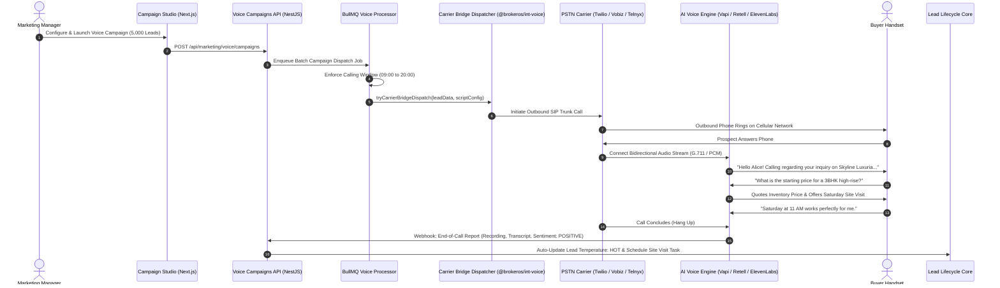

The **BrokerOS AI Voice Marketing Suite** delivers enterprise-grade outbound calling automation for property brokerages and channel partner networks. It empowers marketing teams to dial tens of thousands of prospective buyers simultaneously using natural, human-like voice agents that understand buyer intent, answer property questions, qualify budgets, and book verified site visits directly into the CRM.

Rather than relying on manual telecallers or rigid Interactive Voice Response (IVR) phone trees, BrokerOS combines real-time conversational artificial intelligence with enterprise telecom infrastructure.

---

## High-Level Voice Architecture

BrokerOS decouples AI reasoning from physical telecommunications, supporting two primary outbound calling pathways:

1. **Option A: Direct Platform Calling** (Native PSTN dialing through AI agent platforms like Vapi, Retell, or ElevenLabs).
2. **Option B: Enterprise Carrier Bridge** (BrokerOS routes outbound calls through dedicated PSTN SIP trunks like Twilio, Telnyx, Vobiz, or Exotel, connecting callers to AI brains via real-time media streams).

---

## Core Capabilities of the Voice Suite

<CardGroup cols={2}>
  <Card title="8 AI Agent Platforms" icon="microchip">
    Native adapters for [Vapi](https://vapi.ai), [Retell AI](https://retellai.com), [ElevenLabs](https://elevenlabs.io), [Sarvam AI](https://sarvam.ai), [Bolna](https://bolna.ai), [LiveKit](https://livekit.io), [OpenAI Realtime](https://openai.com), and [Pipecat](https://pipecat.ai).
  </Card>
  <Card title="4 PSTN Telephony Carriers" icon="phone">
    Direct telecom integration with **Twilio**, **Telnyx**, **Vobiz**, and **Exotel** via the central Carrier Bridge Dispatcher.
  </Card>
  <Card title="Specialized Assistant Studios" icon="sliders">
    Dedicated visual studios for Vapi, Retell, and ElevenLabs with full control over LLMs, TTS providers, STT transcribers, and flow mechanics.
  </Card>
  <Card title="Dual-Mode Test Calling" icon="phone-call">
    Verify conversational agents before launch via in-browser WebRTC audio simulation or direct live cellular phone calls.
  </Card>
  <Card title="WebSocket Media Stream Gateway" icon="network-wired">
    Full-duplex WebSocket server on `/voice/stream` featuring real-time G.711 u-law and 16-bit Linear PCM audio transcoding.
  </Card>
  <Card title="Real-Time Sentiment & Auto-Promotion" icon="flame">
    Continuous AI sentiment evaluation mapping positive calls directly to CRM `HOT` leads and automatic site visit bookings.
  </Card>
</CardGroup>

---

## Complete Multi-Platform Matrix

BrokerOS provides deep support across both conversational intelligence engines and physical carrier backbones:

| Component Category | Supported Providers | Integration Package | Key Operational Benefits |
| :--- | :--- | :--- | :--- |
| **AI Voice Platforms** | Vapi, Retell, ElevenLabs, Sarvam, Bolna, LiveKit, OpenAI Realtime, Pipecat | `@brokeros/int-voice` (`integrations/voice/agents/`) | Sub-500ms conversational latency, realistic breathing cadence, dynamic prompt injection. |
| **TTS Speech Engines** | Cartesia Sonic, Deepgram Aura, ElevenLabs, MiniMax, OpenAI TTS, Sarvam Bulbul | `apps/api/src/marketing/voice/services/tts/` | Ultra-fast audio previews, rich Indian and global accents, emotional tone modulation. |
| **STT Transcribers** | Deepgram Nova-2, Talkscriber, Whisper | `apps/api/src/marketing/voice/` | High noise immunity, real estate terminology boosting, instant speech endpointing. |
| **Telephony Carriers** | Twilio, Telnyx, Vobiz, Exotel | `@brokeros/int-voice` (`integrations/voice/telephony/`) | Local CLI presentation, cost-effective domestic termination, automated call recording. |

---

## End-to-End Campaign Workflow

The lifecycle of an autonomous AI voice campaign follows four operational phases:

### 1. Studio Composition & Agent Tuning
Marketing managers build custom voice personas in the **Agent Composer Studio** (`VoiceStep4AgentComposer.tsx`). They select the underlying intelligence model (such as GPT-4o, Claude 3.5 Sonnet, or Gemini 1.5 Flash), configure vocal traits (stability, pitch, speed), and tune conversational flow dynamics (silence timeouts, interruption sensitivity, and voicemail detection).

### 2. Campaign Setup & Compliance Scrubbing
In the **5-Step Campaign Wizard** (`apps/web/features/marketing/voice/wizard/`), teams bind the campaign to a real estate development project, set statutory calling windows (such as 09:00 to 20:00), segment CRM leads or upload CSV files up to 50,000 records, and configure carrier concurrency limits to prevent telephone trunk saturation.

### 3. Background Queue Execution & Pacing
Execution is handed off to BullMQ worker processors (`apps/workers/src/processors/marketing-voice.processor.ts`). The worker verifies local calling hours, normalizes lead variables using `normalizeVoiceLeadVariables`, checks DND suppression lists, and batches outbound dials through the `CarrierBridgeDispatcher` in managed concurrency chunks.

### 4. Real-Time Telemetry & Lead Conversion
As conversations complete, webhooks push audio recordings, full transcripts, and extracted customer sentiment to the CRM. Managers monitor the live **Voice Analytics & Call Logs** table (`VoiceCallLogsTable.tsx`) and can instantly promote high-intent prospects into active deals with assigned sales executives.

---

## Repository Implementation Map

The AI voice system spans across shared packages, integrations, backend microservices, and web interfaces:

- **Frontend Feature**: [apps/web/features/marketing/voice/](https://github.com/trybrokeros/BrokerOS/blob/main/apps/web/features/marketing/voice/)
- **Frontend App Route**: [apps/web/app/dashboard/marketing/voice/](https://github.com/trybrokeros/BrokerOS/blob/main/apps/web/app/dashboard/marketing/voice/)
- **Backend API Module**: [apps/api/src/marketing/voice/](https://github.com/trybrokeros/BrokerOS/blob/main/apps/api/src/marketing/voice/)
- **WebSocket Gateway**: [apps/api/src/marketing/voice/gateway/voice-media-stream.gateway.ts](https://github.com/trybrokeros/BrokerOS/blob/main/apps/api/src/marketing/voice/gateway/voice-media-stream.gateway.ts)
- **Background Worker**: [apps/workers/src/processors/marketing-voice.processor.ts](https://github.com/trybrokeros/BrokerOS/blob/main/apps/workers/src/processors/marketing-voice.processor.ts)
- **Integration Adapters**: [integrations/voice/](https://github.com/trybrokeros/BrokerOS/blob/main/integrations/voice/)
- **Domain Constants & Catalogs**: [packages/constants/src/voice/](https://github.com/trybrokeros/BrokerOS/blob/main/packages/constants/src/voice/)
- **Shared Types**: [packages/types/src/voice/](https://github.com/trybrokeros/BrokerOS/blob/main/packages/types/src/voice/)
