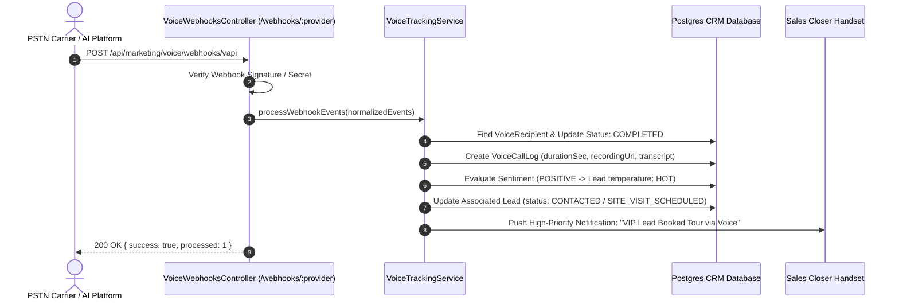

When an outbound telephone conversation concludes, the AI platform or telephony carrier transmits a structured webhook payload back to BrokerOS. This payload contains essential intelligence: the recorded audio MP3 URL, turn-by-turn conversational transcript, duration in seconds, cost metrics, and extracted customer sentiment.

The **Voice Webhook Controller** (`VoiceWebhooksController.ts`) and **Webhook Diagnostics Card** (`VoiceWebhookDiagnostics.tsx`) provide full transparency into webhook routing, signature validation, and payload processing.

---

## Webhook Ingestion & CRM State Synchronization

---

## The 7 Core Webhook Endpoints

BrokerOS maintains dedicated webhook endpoints catering to both telephony call routing and post-call analytics:

| Webhook Route | Provider / Platform | HTTP Method | Expected Payload / Response Behavior |
| :--- | :--- | :--- | :--- |
| **`/webhooks/vapi`** | Vapi AI | `POST` | Ingests `end-of-call-report` event containing recording MP3, full turn-by-turn transcript, and extracted analysis. |
| **`/webhooks/retell`** | Retell AI | `POST` | Ingests `call_analyzed` event with sentiment tags, customer objection notes, and call disconnection reason. |
| **`/webhooks/elevenlabs`** | ElevenLabs | `POST` | Ingests post-call conversational analysis, language detection, and audio recording storage links. |
| **`/webhooks/sarvam`** | Sarvam AI | `POST` | Ingests Indic speech call summaries and language translation logs. |
| **`/webhooks/twilio-answer`** | Twilio Voice | `GET` / `POST` | Returns dynamic TwiML XML to speak greetings or connect live media streams over WebSocket. |
| **`/webhooks/vobiz-answer`** | Vobiz PSTN | `GET` / `POST` | Returns Vobiz XML `<Response><Speak>` instructions for local Indian domestic termination. |
| **`/webhooks/telnyx-answer`** | Telnyx Voice | `GET` / `POST` | Returns TeXML `<Connect><Stream>` to establish bidirectional WebSocket media streaming. |

---

## Real-Time Webhook Diagnostic Simulator

Connecting and testing webhooks across live telephony providers can be cumbersome during development. The **Voice Webhook Diagnostics Studio** (`VoiceWebhookDiagnostics.tsx`) includes an interactive simulation suite built directly into the marketing settings page:

<CardGroup cols={2}>
  <Card title="Simulated AI Platform" icon="microchip">
    Select target platform schema: **Vapi**, **Retell**, **ElevenLabs**, or **Sarvam**.
  </Card>
  <Card title="Simulated Recipient Phone" icon="phone">
    Enter any test phone number (e.g., `+919876543210`) to simulate an inbound event.
  </Card>
  <Card title="Sentiment Override" icon="gauge">
    Test `POSITIVE`, `NEUTRAL`, or `NEGATIVE` sentiment processing.
  </Card>
  <Card title="Executive AI Summary" icon="file-lines">
    Input a synthetic conversation summary describing unit interest and site visit booking requests.
  </Card>
</CardGroup>

### Simulation Execution
Clicking **Dispatch Simulated Webhook** performs an end-to-end test against `/api/marketing/voice/webhooks/:provider`:

1. Generates a valid JSON payload matching the selected platform's official schema.
2. Dispatches an authenticated HTTP POST request to the local or production webhook endpoint.
3. Verifies that the recipient status advances to `COMPLETED`, the call log is created, and the corresponding CRM Lead temperature updates to `HOT`.
4. Renders the raw HTTP response code and parsed event count directly in the interface.

---

## Security & Signature Verification

To prevent unauthorized actors from spoofing call completions or tampering with lead ratings, BrokerOS enforces cryptographic validation across all webhook channels:

- **HMAC-SHA256 Signatures**: Platforms like Retell and ElevenLabs sign request payloads using an HMAC secret key transmitted in HTTP headers (e.g., `x-retell-signature`). BrokerOS recomputes the hash using the stored secret and rejects mismatched requests with HTTP 401 Unauthorized.
- **Vapi Server Secret**: Vapi requests validate against the configured `serverUrlSecret` credential.
- **Telecom IP Whitelisting**: Carrier answer callbacks verify source IP addresses and basic authentication parameters before executing telecommunication media streams.
