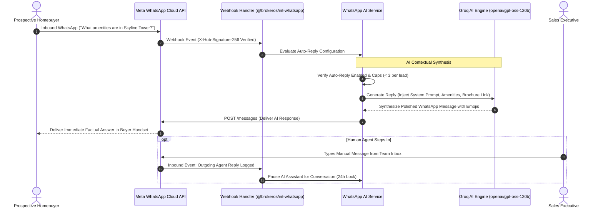

## WhatsApp Intelligence and System Settings

The BrokerOS WhatsApp Settings workspace (`/dashboard/marketing/whatsapp/settings`) centralizes artificial intelligence configurations, Meta Cloud API credentials, webhook diagnostics, and team productivity macros used across WhatsApp inboxes, chatbot flows, and broadcast campaigns.

Key subsystems configured here include:
- **WhatsApp AI Assistant**: Powers automated contextual replies and draft suggestions.
- **WABA Credentials & Phone Numbers**: Manages Meta Business Manager connectivity.
- **Webhook Diagnostics**: Verifies HMAC-SHA256 security signatures and event subscriptions.
- **Quick Replies and Tags**: Curates team message shortcuts and CRM classification labels.

---

## AI Assistant Architecture and Human Handoff



---

## WhatsApp AI Assistant Configuration

Configured through the **WhatsApp AI Config Card** (`WhatsAppAiConfigCard.tsx`):

### Model Selection and Provider
BrokerOS connects to ultra-fast inference models to ensure sub-second conversational responses:
- **Groq `openai/gpt-oss-120b` (Default)**: Sub-second inference speed, allowing the assistant to synthesize helpful, detailed property responses instantly.
- **OpenAI `gpt-4o-mini`**: Alternative model option.
- **AES-256-GCM Encryption**: All BYO API keys are stored encrypted in the database.

### System Prompt Customization
Instruct the AI assistant on communication style and commercial boundaries:
- Define the brokerage's tone (for example, luxury real estate advisor vs accessible family home consultant).
- Instruct the assistant to reference specific project amenities (swimming pool, gym, concierge desk, parking ratios).
- Set rules restricting formal price discounts, directing buyers to schedule a private sales gallery tour for custom commercial offers.

### Autonomous Auto-Reply Safeguards
- **Auto-Reply Toggle (`autoReplyEnabled`)**: Enables autonomous outbound sending without requiring human review.
- **Max Replies Per Lead (`autoReplyMaxPerLead: 3`)**: Limits the number of automated responses on an individual thread to prevent loops.
- **Agent Interruption Back-Off**: If a human sales executive sends any message in the thread, the AI assistant automatically disengages for 24 hours.

---

## Meta Cloud API Credentials Configuration

Configured via the **WhatsApp Config Card** (`WhatsAppConfigCard.tsx`):

- **WhatsApp Business Account (WABA) ID**: The 15-digit identifier for your registered business account.
- **Phone Number ID**: The unique Meta identifier for your active sender phone number.
- **Permanent Access Token**: System User access token generated in Meta Business Manager with `whatsapp_business_messaging` and `whatsapp_business_management` permissions.
- **App Secret**: Used to validate incoming webhook HMAC signatures.

---

## Inbound Webhook Diagnostics and Security

The **Webhook Diagnostics Card** (`WhatsAppWebhookDiagnostics.tsx`) verifies secure communication with Meta:

- **Dedicated Webhook URL**:
  ```http
  https://api.yourdomain.com/api/marketing/whatsapp/webhook
  ```
- **HMAC-SHA256 Signature Validation**: Every incoming payload must carry the `X-Hub-Signature-256` header. The `@brokeros/int-whatsapp` adapter validates this signature against your App Secret before processing, preventing spoofing attacks.
- **Verification Challenge**: Fulfills the Meta GET webhook handshake (`hub.mode`, `hub.verify_token`, `hub.challenge`).
- **Real-Time Diagnostics**: Tests live webhook receipt status for messages, delivery checkmarks, and read receipts.

---

## Quick Replies and Tags Managers

The **Quick Replies Manager** (`QuickRepliesManager.tsx`) and **Tags Manager** (`TagsManager.tsx`) empower sales teams:

- **Quick Reply Shortcuts**: Configure slash commands (such as `/brochure`, `/directions`, `/site-visit`, `/payment-terms`) for instant one-click message composition.
- **CRM Classification Tags**: Curate tags like `#Hot_Buyer`, `#NRI_Investor`, `#Corporate_Client`, or `#Weekend_Tour` used across chatbot flows, contact records, and Kanban pipelines.
