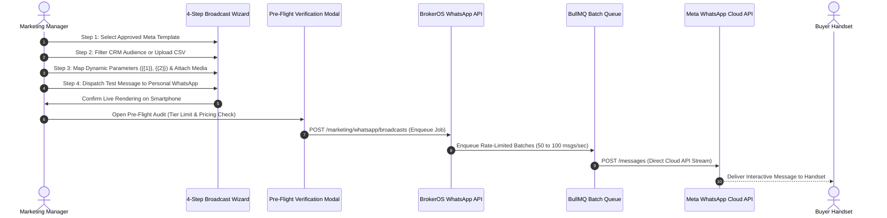

## High-Engagement WhatsApp Broadcasts

WhatsApp broadcasts offer superior engagement for real estate announcements, launch previews, and price revisions, delivering open rates exceeding 95% and reply rates above 25%. BrokerOS coordinates broadcast campaigns through the official Meta Cloud API while actively monitoring and protecting your phone number's health and messaging tier.

The **Broadcast Wizard** (`WhatsAppBroadcastWizard.tsx`) guides marketing specialists through a structured 4-step campaign pipeline from template selection to pre-flight capacity audits.

---

## Campaign Execution Workflow

---

## The Four Wizard Configuration Steps

### Template Selection
- Browse all synced Meta templates across your WhatsApp Business Account.
- Filter by category (`MARKETING`, `UTILITY`, `AUTHENTICATION`) and language code (`en_US`).
- Inspect template preview with header media slots (PDF brochure, promotional video, or hero rendering).

### Audience Selection and Segmentation
- **CRM Leads**: Segment active prospects by assigned project, lead pipeline status (`NEW`, `CONTACTED`, `INTERESTED`), qualification temperature, or budget bracket ($\ge \$750,000$).
- **CSV List Ingest**: Upload external high-net-worth investor contact lists with automatic phone number normalization to E.164 international standard.
- **Opt-In Verification**: Automatically filters out unsubscribed contacts or previously failed numbers.

### Personalization and Parameter Mapping
Because approved Meta templates have locked copy, dynamic content is injected into numerical parameters (`{{1}}`, `{{2}}`, `{{3}}`) at runtime:
- `{{1}}`: Mapped to `Lead.firstName` (for example, "Rahul" or "John").
- `{{2}}`: Mapped to `Project.name` (for example, "Skyline Residences").
- `{{3}}`: Mapped to `Project.startingPrice` (for example, "$650,000").
- **Dynamic Media Header**: Attach a direct URL to the project PDF cut-sheet or master layout.

### Review, Pre-Flight Audit, and Schedule
- **Live Test Message**: Dispatch a live test to your smartphone to verify button actions and media rendering.
- **Pre-Flight Capacity Audit**: Evaluates audience volume against your active Meta messaging tier limit (Tier 1K, 10K, 100K, Unlimited).
- **Cost Estimation**: Displays calculated conversation costs based on target volume and category rate.
- **Dispatch Scheduling**: Choose between **Send Now** or schedule for high-open windows (such as Tuesday through Thursday mornings from 10:00 AM to 11:30 AM).

---

## Delivery, Read, and Reply Tracking

During and after campaign dispatch, BrokerOS tracks delivery stages in real time:

- **Queued**: Message payload compiled and waiting in the BullMQ execution worker.
- **Sent**: Dispatched from BrokerOS API to the Meta WhatsApp Cloud API endpoint.
- **Delivered**: Successfully received on the prospect's mobile device (double gray checkmarks).
- **Read**: Opened by the recipient (double blue checkmarks received via webhook).
- **Replied**: Buyer clicked a Quick Reply button or typed an inbound response. Inbound replies immediately open a 24-hour conversational window in the **Team Inbox**.
