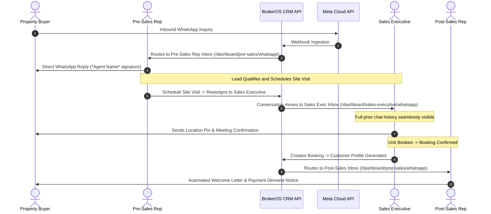

## Departmental Scoping Overview

In BrokerOS, real estate client communications are not isolated to marketing broadcasts. Every operational department requires direct, real-time WhatsApp messaging with prospects, clients, and channel partners while strictly honoring data governance boundaries.

Rather than maintaining separate chat applications or permitting agents to use unmonitored personal phones, BrokerOS implements a **Universal Engine with Role-Scoped Workspaces**:

- **Pre-Sales**: Communicates only with assigned early discovery leads (`NEW`, `CONTACTED`, `INTERESTED`).
- **Sales Executive**: Takes over lead communication immediately upon site visit scheduling (`SITE_VISIT_SCHEDULED`, `NEGOTIATION`, `BOOKING`).
- **Post-Sales**: Direct WhatsApp engagement with confirmed buyers for documentation, home loans, milestone billing, and possession handover.
- **Sourcing Manager**: Communicates strictly with assigned Channel Partner (CP) brokers regarding inventory availability, site visits, and commission settlements.
- **Closing Manager**: Stationed on-site at sales galleries, managing walk-in leads and on-site negotiation prospects.
- **Finance**: Oversees payment collections, demand notices, receipts, and CP commission disbursements.
- **Managers & Directors**: Maintain team-wide oversight with interactive filters to inspect subordinate conversation velocity.

---

## Architectural Workflow: Lead Handoff & History Preservation

When a lead transitions across departments, such as from Pre-Sales to Sales Executive upon scheduling a site visit, the conversation history remains unified while the active inbox routing shifts automatically.



---

## Role Scoping Matrix

The backend enforces data isolation through [`apps/api/src/marketing/whatsapp/conversations/whatsapp-conversations.service.ts`](https://github.com/trybrokeros/BrokerOS/blob/main/apps/api/src/marketing/whatsapp/conversations/whatsapp-conversations.service.ts):

| Department Role | Scope Filter | Visible Entities | In-App UI Route |
| :--- | :--- | :--- | :--- |
| **Pre-Sales Executive** | `my` | Leads where `assignedUserId = currentUser.id` and status in (`NEW`, `CONTACTED`, `INTERESTED`) | `/dashboard/pre-sales/whatsapp` |
| **Pre-Sales Manager** | `team` | All leads assigned to direct subordinates, with executive dropdown filter | `/dashboard/pre-sales-manager/whatsapp` |
| **Sales Executive** | `my` | Leads where `assignedUserId = currentUser.id` and status in (`SITE_VISIT_SCHEDULED`, `NEGOTIATION`, `BOOKING`) | `/dashboard/sales-executive/whatsapp` |
| **Sales Manager** | `team` | All leads assigned to subordinate sales executives, with deal velocity tracking | `/dashboard/sales-manager/whatsapp` |
| **Post-Sales Executive** | `my` | Customers where `booking.assignedPostSalesId = currentUser.id` | `/dashboard/post-sales/whatsapp` |
| **Post-Sales Manager** | `team` | All post-booking customer threads across all team post-sales executives | `/dashboard/post-sales-manager/whatsapp` |
| **Sourcing Manager** | `my` | External CP Brokers where `broker.sourcingManagerId = currentUser.id` | `/dashboard/sourcing-manager/whatsapp` |
| **Closing Manager** | `my` | Walk-in leads created on-site or leads assigned at their project sales gallery | `/dashboard/closing-manager/whatsapp` |
| **Finance Department** | `all` | Customers with payment transactions and Brokers with commission claims | `/dashboard/finance/whatsapp` |
| **Business Manager** | `all` | Enterprise-wide operational visibility across both Brokerage and CP network | `/dashboard/business-manager/whatsapp` |
| **Director & Admin** | `all` | Full organizational oversight with real-time audit capabilities | `/dashboard/director/whatsapp` |

---

## Key Operational Features

### 1. Automated Executive Provisioning
When a manager assigns new leads or brokers to an executive, BrokerOS automatically provisions conversation records even if the contact has not sent an inbound message yet. The contact appears in the executive's directory with a `"New • Uncontacted"` badge, allowing immediate outbound engagement.

### 2. Verified Sender Signatures
Because all departmental messages route through a single verified Meta WhatsApp Business Account (WABA), BrokerOS automatically prefixes outgoing agent replies with their name:
```text
*John Doe*: Hello Mr. Sharma, I have attached the updated floor plan for Tower C.
```
This ensures buyers always know which representative they are speaking with while maintaining company brand identity.

### 3. Meta 24-Hour Session Enforcement
- **Within 24 Hours**: Executives can send free-form text, attachments, photos, and location coordinates.
- **Outside 24 Hours**: The input bar locks automatically, presenting a one-click template selector. When the client replies, the free-form window reopens automatically.

### 4. Deep-Linking from CRM Profiles
In both the Lead Profile and Broker Profile headers, clicking the **WhatsApp** action navigates directly to the current department's WhatsApp inbox:
- `/dashboard/pre-sales/whatsapp?leadId=[id]`
- `/dashboard/sales-executive/whatsapp?leadId=[id]`
- `/dashboard/sourcing-manager/whatsapp?brokerId=[id]`
Hold **Alt + Click** to open external WhatsApp Web if an executive specifically needs personal web access.
