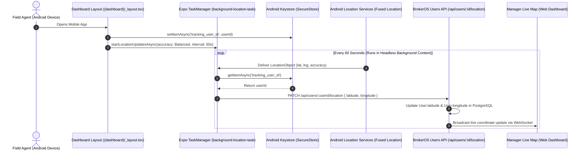

## Overview

BrokerOS automatically monitors the real-time geographic location of field agents (Sales Executives, Sourcing Managers, and Closing Managers) during their scheduled working shifts.

This tracking provides two core enterprise capabilities:
1. **Live Management Oversight**: Sales managers can view their entire field team on an interactive Google Maps overlay in the web dashboard.
2. **Site Visit Validation**: Real-time coordinates verify that sales executives were physically present at designated project sites during client meetings.

---

## Tracking Pipeline Architecture



---

## Headless Background Task Architecture

The location tracking subsystem ([`apps/mobile/lib/location-tracking.ts`](file:///c:/Users/Sumama/Desktop/enterprise-crm-realtors/apps/mobile/lib/location-tracking.ts)) uses `expo-location` and `expo-task-manager` to register a background task:

```typescript
export const LOCATION_TASK_NAME = 'background-location-task';
const USER_ID_KEY = 'tracking_user_id';
```

### Why SecureStore is Required for Headless Tasks
When the mobile application is minimized or the device screen is locked, Android spawns a **headless JavaScript context** to execute location updates. In this headless environment:
- React state, context hooks, and component memory do not exist
- Active session objects and web clients are uninitialized

To ensure the backend knows which employee is broadcasting coordinates, the dashboard shell writes the authenticated `userId` to **`expo-secure-store`** during boot. The headless task reads `USER_ID_KEY` from disk on every execution tick.

---

## Foreground Service Configuration

To prevent the Android operating system from killing the tracking process during background battery optimization, BrokerOS runs an Android Foreground Service with a persistent notification:

```typescript
await Location.startLocationUpdatesAsync(LOCATION_TASK_NAME, {
  accuracy: Location.Accuracy.Balanced,
  timeInterval: 1 * 60 * 1000,    // Executes every 1 minute
  distanceInterval: 0,             // Triggers even if stationary
  deferredUpdatesInterval: 1 * 60 * 1000,
  showsBackgroundLocationIndicator: true,
  foregroundService: {
    notificationTitle: 'Live Tracking Active',
    notificationBody: 'Your location is being shared with the dashboard.',
    notificationColor: '#2563eb',
  },
});
```

This persistent notification informs field employees that their location is being actively logged and ensures continuous execution across all Android OEM battery managers (Samsung, Xiaomi, OnePlus, Google Pixel).

---

## Production Optimizations & Privacy Filters

The tracking module in [`apps/mobile/lib/location-tracking.ts`](file:///c:/Users/Sumama/Desktop/enterprise-crm-realtors/apps/mobile/lib/location-tracking.ts) contains configurable enterprise safeguards:

### 1. Off-Duty Hours Filter
Prevents tracking outside business operating hours (e.g., between 11:00 PM and 6:00 AM):
```typescript
const currentHour = new Date().getHours();
if (currentHour >= 23 || currentHour < 6) {
  // Off-duty hours. Skip location transmission.
  return;
}
```

### 2. Distance Threshold (Haversine Delta)
Skips redundant backend API calls if the agent has moved less than 10 meters since the previous recorded ping:
```typescript
const dist = getDistanceMeters(Number(lastLat), Number(lastLng), lat, lng);
if (dist < 10) {
  // Movement under 10 meters. Skip API transmission to save battery.
  return;
}
```

---

## Required Permissions & User Experience

| Permission Scope | Android Declaration | User Experience |
| :--- | :--- | :--- |
| **Foreground Location** | `ACCESS_FINE_LOCATION`, `ACCESS_COARSE_LOCATION` | Requested upon initial dashboard mount. Provides high-precision coordinates. |
| **Background Location** | `ACCESS_BACKGROUND_LOCATION` | Prompts user to select "Allow all the time" in Android system settings. |
| **Foreground Service** | `FOREGROUND_SERVICE_LOCATION` | Required for continuous location broadcast notifications on Android 14+. |

<Warning>
  If an employee revokes background location permissions, tracking terminates when the app is minimized. The management dashboard will display their last known pin with a "Location Stale" warning indicator.
</Warning>
