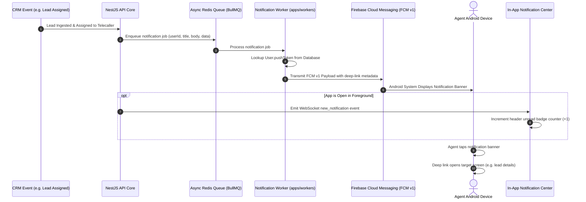

## Overview

BrokerOS delivers low-latency push notifications to field agents and telecallers via **Firebase Cloud Messaging (FCM v1)** and Expo Notifications.

Push notifications alert employees to high-priority operational events:
- Fresh lead inquiries assigned by managers or ingested via Meta and Google Ads
- Escalated discount approvals and pricing waivers
- Daily morning follow-up call reminders
- Confirmed unit bookings and token deposit receipts
- Direct mentions and priority team chat messages

---

## Notification Pipeline Architecture



---

## Push Token Registration Lifecycle

When an employee opens the mobile app:
1. **Permission Request**: Expo Notifications requests notification runtime permissions (`POST_NOTIFICATIONS` on Android 13+).
2. **Token Generation**: Expo registers with Firebase and retrieves a unique device push token.
3. **Database Association**: The mobile client sends the token to `PATCH /api/users/push-token`, saving it in PostgreSQL (`User.pushToken`).
4. **Targeted Dispatch**: Whenever system events affect that user, the BullMQ worker targets their specific hardware token.

If an employee changes phones or reinstalls the app, a fresh token is generated and updated automatically upon first login.

---

## Trigger Events & Notification Payloads

| System Event | Recipient Role | Notification Message Preview |
| :--- | :--- | :--- |
| **New Lead Assigned** | Assigned Pre-Sales Telecaller | *"New Lead: Rajesh Kumar is interested in Skyline Heights (3BHK)."* |
| **Lead Reassignment** | Newly Assigned Agent | *"Lead Reassigned: Priya Singh has been transferred to your queue."* |
| **Morning Follow-Up Due** | Assigned Agent | *"Follow-Up Reminder: You have 6 follow-up calls scheduled for today."* |
| **Discount Approved** | Submitting Sales Executive | *"Discount Approved: Unit A-304 discount of ₹2,50,000 has been sanctioned."* |
| **Discount Rejected** | Submitting Sales Executive | *"Discount Rejected: Unit B-201 discount exceeds delegation authority."* |
| **Site Visit Verified** | Assigned Sales Executive | *"Site Visit Approved: Amit Sharma visit verified by manager."* |
| **Unit Booking Confirmed** | Project Sales Manager | *"New Booking Confirmed: Unit C-501 booked with ₹5,00,000 token."* |
| **Direct Chat Message** | Recipient Colleague | *"New Message from Rahul: 'Can you check client Ramesh documents?'"* |

---

## In-App Notification Center

In addition to background system banners, the mobile app includes an **in-app notification center** accessible via the bell icon in the dashboard header:

```tsx
// Inside apps/mobile/app/(dashboard)/_layout.tsx
<Pressable
  onPress={() => {
    Haptics.impactAsync(Haptics.ImpactFeedbackStyle.Light);
    setUnreadCount(0);
    router.push('/(dashboard)/notifications');
  }}
  className="w-9 h-9 rounded-xl bg-slate-50 items-center justify-center border border-slate-200/80 mr-2.5 active:scale-95 relative"
>
  <Bell size={18} color="#0f172a" />
  {unreadCount > 0 && (
    <View className="absolute -top-1 -right-1 bg-rose-600 rounded-full min-w-[16px] h-4 px-1 items-center justify-center border border-white">
      <Text className="text-[9px] font-black text-white">
        {unreadCount > 99 ? '99+' : unreadCount}
      </Text>
    </View>
  )}
</Pressable>
```

- **Live Counter**: Unread badge count increments in real time via Socket.IO events (`new_notification`).
- **Interactive Deep Linking**: Tapping a notification navigates directly to the associated lead profile, booking agreement, or approval sheet.

---

## Build Configuration: Firebase & FCM v1

Firebase is embedded at build time using [`apps/mobile/google-services.json`](https://github.com/trybrokeros/BrokerOS/blob/main/apps/mobile/google-services.json):

1. **Firebase Project**: Register an Android application under the package name `com.anonymous.mobile` (configured in [`apps/mobile/app.json`](https://github.com/trybrokeros/BrokerOS/blob/main/apps/mobile/app.json)).
2. **Download File**: Download `google-services.json` and save it to the `apps/mobile/` root directory.
3. **Expo Dashboard Credentials**: In [expo.dev](https://expo.dev), navigate to your project -> **Credentials -> Android -> Push Credentials** and upload your Google Service Account private key JSON for FCM v1 delivery.
4. **Compile Build**: Run `npx expo run:android` or EAS build to embed the configuration into the native APK.
