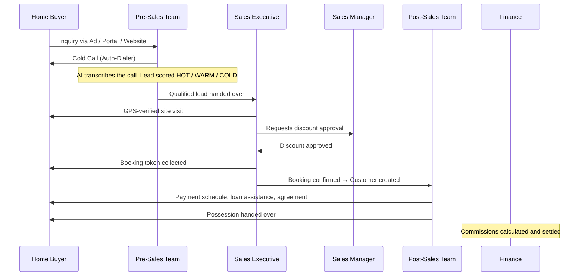

## From Lead to Handover

Every property sale in BrokerOS follows the same path no matter the team, no matter the project:

---

## The Three Core Loops

### Loop 1: The Brokerage Sales Loop

Your in-house team takes a stranger and turns them into a property owner.

1. **Lead Ingestion**: A lead arrives from a Meta Ad, Google Ad, 99acres, MagicBricks, or a manual walk-in.
2. **Pre-Sales Qualification**: A telecaller calls the lead using the auto-dialer on their Android phone. The AI listens, transcribes the call, and rates the lead as HOT, WARM, or COLD.
3. **Site Visit**: The qualified buyer is invited to tour the project. The visit is confirmed with a selfie and GPS coordinates: no manual check-ins needed.
4. **Negotiation**: If the buyer wants a better price, the sales executive raises a discount request. The manager reviews it and approves or rejects it: all inside the app.
5. **Booking**: The buyer pays a token amount, the unit is locked, and the lead officially becomes a Customer record.
6. **Post-Sales**: A post-sales executive takes it from here: documents, home loan, sale agreement, and eventually the key handover.

---

### Loop 2: The Channel Partner (CP) Loop

External real estate brokers bring their own clients to your projects.

1. **Broker Onboarding**: A Sourcing Manager brings a broker on board, verifies their RERA, GST, and PAN details, and links them to a project.
2. **Client Walk-In**: The broker brings a buyer to the project site.
3. **Closing**: A Closing Manager meets them on-site, runs the tour, and closes the booking.
4. **Commission Settlement**: BrokerOS calculates the commission automatically, logs it as a Brokerage Record, and Finance processes the payout once milestones are cleared.

---

### Loop 3: The Marketing Loop

The marketing team runs campaigns to generate new leads and re-engage existing ones: at scale.

1. **Audience Selection**: Pick leads from a project segment or upload a CSV file.
2. **Channel Selection**: Choose from AI Voice, WhatsApp, SMS, or Email.
3. **Campaign Launch**: BrokerOS queues everything in the background and sends to thousands of contacts with controlled pacing: nothing blocks the app.
4. **Lead Sync**: Leads from Meta and Google Ads land in the CRM automatically the moment someone fills out a form.
